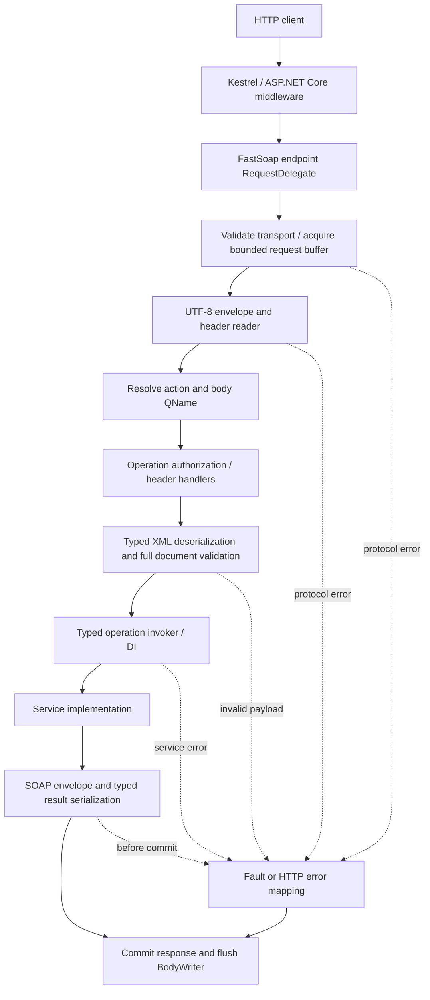

# FastSoap — Framework implementation specification

**Revision:** 2.0 — research-informed update, 2026-11-26  
**Status:** Proposed architecture and agent work plan; architecture selection conditional on research gate R0; not an implemented or benchmarked framework  
**Target:** .NET 10 LTS, SOAP over HTTP/HTTPS, Native AOT and JIT  
**Working name:** FastSoap (package names and trademarks must be checked before publication)  
**Primary dependency:** [CloudNimble/XmlEssentials](https://github.com/CloudNimble/XmlEssentials)  
**Audience:** Maintainers, implementation agents, reviewers, test and performance engineers

## 0. Instructions to all implementation agents

Treat this document as the initial shared specification. Do not independently redesign the public APIs, SOAP semantics, or dependency graph. Propose changes as architecture decision records (ADRs), obtain maintainer agreement, and update the shared contract and tests before changing dependent packages.

Each agent must work in its assigned package or files, start from the agreed foundation commit, use a separate branch/worktree, provide tests alongside code, and submit a small reviewable pull request. Do not edit shared solution files, central package versions, golden fixtures, or public abstractions without coordinating with the integration owner. Do not introduce new packages without documenting their need, license, and AOT impact. Do not suppress trim or AOT diagnostics merely to obtain a successful build. No agents should claim a performance improvement unless it is measured against an equivalent baseline.

Priority order: wire correctness and security; compatibility; predictable ownership/lifetimes; AOT; then measured performance. Favor simple explicit code before speculative optimizations. All API fragments in this document are proposed signatures unless specifically identified as upstream APIs. The foundation agent must reconcile them with the pinned dependency version and publish the final interfaces before downstream work begins.

## 1. Purpose and scope

The leading hypothesis is an independent SOAP runtime on ASP.NET Core, rather than a CoreWCF fork. Gate R0 must compare this with a CoreWCF extension and a SoapCore adaptation before committing to that choice. The rest of this specification describes the independent-runtime path if approved; do not implement it in full before that decision. Reuse Kestrel, routing, DI, authentication, authorization, TLS, logging, and hosting from ASP.NET Core. Reuse XmlEssentials for UTF-8 XML reading, writing, and source-generated serialization. Implement only the SOAP-specific protocol, operation mapping, metadata and client interoperability machinery that is necessary.

### 1.1 Release scope

| Capability | M1: vertical slice | M2: usable v0.1 | Later |
|---|---|---|---|
| SOAP 1.1, UTF-8, POST, HTTP/HTTPS | Yes | Harden | |
| Document/literal wrapped, one logical input and output | Yes | WCF interop | Multiple parameters, bare contracts |
| SOAP 1.2 HTTP binding, without WS-Addressing | | Yes | |
| SOAP faults and header semantics | Basic | Complete for supported profile | Typed extensibility |
| Contract attributes and typed manual mapping | Yes | Yes | |
| Generated operation registration and invokers | | Yes | More contract shapes |
| WSDL 1.1 and XSD | Static fixture | Supplied/verified static artifacts, generated subset | Broader schema generation |
| ASP.NET authentication/authorization | Yes | Harden | |
| Native AOT server | Yes | CI release gate | Additional RIDs |
| Bounded buffered requests and responses | Yes | Yes | True incremental streaming |
| Existing WCF clients | Initial test | Supported-profile matrix | Broader compatibility |
| FastSoap client / proxy generator | | | Optional separate milestone |
| WS-Addressing, MTOM, WS-Security | | | Separate design and security review |
| NetTcp, duplex, reliable messaging, transactions, RPC/encoded | | | Not committed |

The initial release is not a drop-in CoreWCF replacement. It targets wire compatibility with selected BasicHttpBinding document/literal contracts, not every attribute or serializer behavior. SOAP 1.2 support does not imply WSHttpBinding support. UTF-16, DTD, XML 1.1, SOAP encoding, and external schema resolution are excluded from v0.1. Define and document the exact wire profile, including namespace rules and supported XSD types.

### 1.2 Non-functional goals

- No reflection-based service discovery, dynamic invocation, runtime code emission, or reflection serializer fallback in the default runtime.
- Publish and execute a Native AOT sample on Linux x64; also test JIT on Linux and Windows. Support more RIDs only after CI proves them.
- No XML string/DOM round trip on the standard request path; no full `Message` abstraction or WCF channel stack.
- Bounded allocation and concurrency, secure input handling, cancellation and graceful shutdown.
- Preserve compatibility with standard SOAP clients without requiring a FastSoap client SDK.
- Measure latency, throughput, allocations, startup and working set. Proposed initial stretch targets: at least 1.3x throughput or 25% lower CPU/request, and 30% lower allocated bytes/request versus comparable CoreWCF JIT for medium CPU-bound payloads. These are engineering targets, not predictions or unconditional release promises.

## 1.3 Research findings and strategic positioning (revision 2)

The preceding research identified substantial overlapping work. FastSoap is not the first effort to bring AOT, generated serializers or modern buffers to SOAP. Its proposed differentiation is the combination of a narrow HTTP wire profile, UTF-8-native processing and a typed dispatch boundary without the legacy WCF channel/message stack. This is a hypothesis, not proof of uniqueness or superior performance.

### Upstream evidence and implications

Status below is the snapshot from the preceding review on 2026-11-26, not a promise that changes will merge. Draft author-reported tests are not independently reproduced. Agents must record exact upstream commit SHAs, package versions, status, license and reproduction commands during R0.

| Source | Research finding | Required consequence |
|---|---|---|
| [CoreWCF #1766](https://github.com/CoreWCF/CoreWCF/pull/1766), open draft | Generated DataContractSerializer, reflection-free operation body path, optional reflection fallback; reported 81/86 byte-identical write cases, 79/86 readable cases, working AOT HTTP smoke test with 339 trim/AOT warnings | Examine serializer seam and design record, build compatibility oracle, reject unsupported contract shapes explicitly, test full runtime AOT instead of only XML |
| [CoreWCF #1750](https://github.com/CoreWCF/CoreWCF/issues/1750), open | Proposed migration from BufferManager toward IBufferWriter; buffer ownership crosses public APIs and configured pool limits matter | Design ownership, quota accounting and disposal independently of transport API; never mix pools |
| [CoreWCF #1758](https://github.com/CoreWCF/CoreWCF/pull/1758), open | Adapter backed by the incumbent BufferManager; intentionally narrow buffered-read refactor; earlier #1751 abandoned due to ownership and compatibility errors | Add deterministic pool accounting and exception-path parity tests; avoid equating an adapter with elimination of copies |
| [CoreWCF #801](https://github.com/CoreWCF/CoreWCF/pull/801), open | ReadOnlySequence-based message decoding proposed | Study segmented input lifetime; keep v0.1 bounded copy until incremental parsing and backpressure are proven |
| [CoreWCF v1.6 discussion #1447](https://github.com/CoreWCF/CoreWCF/discussions/1447) | Generated operation invokers already exist | Enable generated invokers for a fair baseline; compare generated object-array boundary with typed handlers, not with an artificially slow reflection baseline alone |
| [CoreWCF #1048](https://github.com/CoreWCF/CoreWCF/issues/1048), open | CoreWCF 2.x breaking-change tracking | Assess upcoming API direction; do not rely on unmerged APIs |
| [dotnet/runtime #125299](https://github.com/dotnet/runtime/issues/125299) | Proposal for modern System.Text.Xml-style APIs | Monitor direction; keep an internal XML backend seam, no dependency on a hypothetical future BCL API |
| [dotnet/runtime #106580](https://github.com/dotnet/runtime/issues/106580), [#71350](https://github.com/dotnet/runtime/issues/71350), [#32555](https://github.com/dotnet/runtime/issues/32555) | Related AOT/async XML serialization discussions | Review alternative strategies and avoid runtime reflection fallback in the AOT product path |
| [SoapCore](https://github.com/DigDes/SoapCore) | Existing ASP.NET Core SOAP middleware with WSDL and serialization extension points | Mandatory alternative architecture investigation and benchmark baseline; verify actual current dispatch, serialization, AOT and buffer seams from pinned code |
| [SmartWsdlKit.SourceGenerators](https://www.nuget.org/packages/SmartWsdlKit.SourceGenerators) and [gSOAP](https://www.genivia.com/) | Related client-generation and native schema-driven approaches | Reference for future client tooling; no initial runtime dependency; verify scope and license before reuse |
| [XmlEssentials](https://github.com/CloudNimble/XmlEssentials) | New UTF-8-first XML backend with generated contexts and promising library-authored microbenchmarks | Qualify exact pinned version; measure on .NET 10 against equivalent workloads; BCL preset is not DCS compatibility |

### Lessons from CoreWCF #1766

The draft is useful for its test methodology and serializer abstraction, not as a ready-made dependency. It focuses on operation body serialization and does not cover every serializer entry point (primitive formatter, faults, headers and security-related paths). It reports contract-discovery trimming problems, and a reflection path that could silently omit members after trimming. A working AOT smoke test is therefore insufficient if warnings and wire fidelity remain unaddressed. It also identifies unsupported or asymmetric cases, including contracts without accessible parameterless constructors and some polymorphic object graphs. Those are findings about the draft, not automatic limitations of XmlEssentials.

Use reference serializers in JIT-only tests to generate immutable golden fixtures. Classify each fixture as supported, explicitly unsupported, or pending. Compare semantics (expanded QNames, required member order, nil, references, known types, enums, collections) and deterministic bytes where exact output matters. Never count skipped or unsupported cases as compatibility successes. Do not import the draft's reflection fallback into FastSoap. Capture compiler diagnostics at build time for unsupported shapes where possible and fail startup for unsupported registrations rather than silently losing data. Verify the entire published native HTTP service, including faults, headers, authorization and metadata, with an independent client; the WCF client itself need not be AOT.

### Lessons from CoreWCF buffer and dispatch work

A pooled buffer is an ownership contract, not merely an allocation optimization. The draft buffer work illustrates why a buffer rented by one pool must not be returned to another, why capacity and logical length are distinct, and why quota violations and failed reads must still return rentals. Use a deterministic tracking pool in tests. Account for simultaneous old/new rentals during growth and concurrent requests. Keep any segmented input valid only within its explicit ownership scope.

Generated invokers are not novel in CoreWCF. Our typed boundary must be independently measured against its generated invoker path. No claim of reduced boxing or allocation should be accepted without profiling; typed preparation can itself allocate and asynchronous operations may introduce state-machine allocations.

### R0 — research and architecture decision gate (before full implementation)

Run short, isolated spikes with identical Echo and nested Transfer wire contracts, a small fixed set of positive/negative XML fixtures, common HTTP settings and equivalent validation. Keep spike code out of production packages until an ADR approves its use. Three tracks are mandatory:

| Track | Experiment | Decision evidence |
|---|---|---|
| R0-A: CoreWCF extension | Test a custom formatter and, where feasible, the encoder seam; inspect #1766 and generated invokers | Copies/transcoding, remaining System.Xml coupling, AOT diagnostics, compatibility preserved, maintenance cost |
| R0-B: SoapCore adaptation | Trace middleware, serializer and WSDL extension points; attempt a minimal XmlEssentials-backed operation | Ability to avoid Message/XmlReader bridging, runtime discovery and dynamic code; native publish/run; protocol reuse, dependency/upgrade cost |
| R0-C: independent runtime | Bounded UTF-8 envelope reader, authored XmlEssentials context, typed handler and staged reply | Native HTTP executable, matching wire fixtures, measured XML/dispatch cost, protocol and metadata implementation effort |

If a spike cannot build or a draft is incompatible, document the exact blocker; do not convert a missing measurement into a performance claim. Use a common released CoreWCF and SoapCore baseline; any draft branch comparison is separate and labeled experimental. Qualify dependency APIs, read/write namespace handling, unsupported shapes, parser quotas, licensing, AOT diagnostics and buffer lifetimes. Compare maintenance and interoperability risks in addition to latency, allocations and CPU/request. Record measured values and the environment, not just architecture diagrams.

**Deliverables:** `docs/research/upstream-matrix.md`, `docs/research/spike-results.md`, `docs/research/compatibility-corpus.md`, `docs/research/dependency-licenses.md`, reproducible spike harnesses under `experiments/`, and accepted ADR-001 with a go/no-go decision and scope. Include a table of claims vs evidence vs unresolved questions. A0 and C0 may work on nonbinding foundation/qualification in parallel; no dependent production implementation begins until R0 and Gate 0 pass. If the extension or SoapCore adaptation wins, revise the package graph and work packages instead of treating this greenfield plan as mandatory.

**Decision rule:** favor an existing framework if it meets the agreed supported wire profile, AOT and performance criteria with materially lower maintenance/security burden. Choose the independent runtime only when the existing extension paths impose significant verified limitations or complexity and the minimal greenfield spike provides a viable alternative. If the results are inconclusive or the XML backend fails qualification, stop and resolve the blockers rather than committing to a rewrite. Consider opening a CoreWCF discussion about an optional UTF-8 fast path; upstream contribution and publication require maintainer approval, not an autonomous agent action.

## 2. Architecture decisions to freeze before parallel implementation

| ADR | Decision | Rationale |
|---|---|---|
| 001 | Conditional independent runtime; finalize after R0 | Avoid legacy channel and message abstractions only if comparative evidence supports it |
| 002 | .NET 10 baseline, pinned SDK and exact XmlEssentials version | Reproducibility; dependency is new and targets modern .NET |
| 003 | Explicit XML contexts and wire DTOs in v0.1 | AOT and deterministic XML names; avoid cross-generator ordering assumptions |
| 004 | Bounded buffered requests first | Correct ownership, simpler complete-document validation, no pipe deadlocks |
| 005 | Stage bounded responses by default | Do not commit partial success if serialization fails |
| 006 | Static typed invokers and immutable operation tables | Avoid reflection and object[] in hot path |
| 007 | Strict document/literal wire contract and exact QName matching | Interoperability and safe routing |
| 008 | ASP.NET middleware and endpoint authorization | Do not implement bespoke HTTP security |
| 009 | Explicit supported schema subset and static WSDL fallback | Prevent incorrect metadata claims |
| 010 | Protocol core independent of hosting | Test without Kestrel; reusable SOAP logic |
| 011 | Internal XML backend seam, no public interchangeable-parser promise | Isolate version-specific XmlEssentials calls; keep typed static path; no speculative generic XML abstraction |
| 012 | Separate wire compatibility corpus from implementation | Reference serializers as JIT-only oracles; explicit supported/excluded cases and independent native HTTP tests |
| 013 | Ownership and budget explicit at every I/O boundary | No cross-pool returns, hidden borrowed spans, or unaccounted growth/concurrency |
| 014 | Compare against released CoreWCF with generated invokers and SoapCore | Fair baselines; experimental upstream branches reported separately |

### 2.1 Runtime data flow



This diagram is logical, not a requirement for two passes over the XML. The initial parser may validate and deserialize in a single synchronous pass and return a prepared typed invocation. See section 5 for async authorization and buffer lifetime constraints.

### 2.2 Repository layout and dependency direction

```text
FastSoap.sln
AGENTS.md                        # Shared agent conventions; foundation owner creates
Directory.Build.props
Directory.Packages.props
Directory.Build.targets
global.json                      # Pinned SDK
NuGet.config
src/
  FastSoap.Abstractions/         # Public contracts, names, options, fault models
  FastSoap.Core/                 # Protocol, dispatch, buffer ownership, XML integration
  FastSoap.AspNetCore/           # HTTP integration, endpoint mapping, DI, auth
  FastSoap.Generators/           # Incremental generators and analyzers
  FastSoap.Metadata/             # WSDL/XSD models and deterministic artifact emission
  FastSoap.Client/               # Reserved; not a v0.1 dependency
samples/
  FastSoap.Sample.Payments/
  FastSoap.Sample.NativeAot/
  FastSoap.Sample.WcfClient/
tests/
  FastSoap.UnitTests/
  FastSoap.ProtocolTests/
  FastSoap.SerializationTests/
  FastSoap.IntegrationTests/
  FastSoap.GeneratorTests/
  FastSoap.MetadataTests/
  FastSoap.CompatibilityTests/
  FastSoap.AotTests/
  FastSoap.SecurityTests/
  fixtures/                     # Shared immutable SOAP, WSDL, XSD fixtures
benchmarks/
  FastSoap.Benchmarks/
  FastSoap.LoadTests/
experiments/                     # R0 spikes, not shipping runtime packages
docs/
  research/                       # Evidence, spike results, corpus and licensing
  adr/
  architecture.md
  compatibility.md
  security.md
  performance.md
  agent-work-packages.md
```

Dependency graph (`A -> B` means A references B):

- `Core -> Abstractions + XmlEssentials`
- `AspNetCore -> Core + Abstractions + Microsoft.AspNetCore.App` (framework reference)
- `Metadata -> Abstractions` (+ XmlEssentials if emitting XML); runtime HTTP metadata adapter in AspNetCore or optional integration package, no cycle.
- `Generators -> Roslyn` (analyzer target `netstandard2.0` where supported; recognize runtime symbols by metadata name; no runtime reference to compiler packages).
- `Abstractions` must not reference ASP.NET Core or Roslyn; use only BCL contracts. Keep `XmlTypeInfo<T>` references in Core/hosting registration rather than the transport-neutral public contracts.
- For the independent-runtime path, no production dependency on CoreWCF or SoapCore; only test/baseline and experimental projects may reference them. Test-only BCL XML APIs, schema validators and WCF tools are allowed. Metadata tooling may use BCL XML tooling at build time if documented; it must not compromise the AOT runtime.

For v0.1 keep the number of runtime packages small. Do not create separate services or processes for the framework. No message broker or database is required.

## 3. Public programming model and contract mapping

### 3.1 Code-first service contract

The intended API is familiar to WCF users without requiring WCF attributes:

```csharp
[SoapService(Namespace = "urn:payments")]
public interface IPaymentService
{
    [SoapOperation(Action = "urn:payments/IPaymentService/Transfer")]
    Task<TransferResult> TransferAsync(
        TransferRequest request, CancellationToken cancellationToken);
}
```

Proposed attributes: `SoapServiceAttribute` (Name, Namespace), `SoapOperationAttribute` (Name, Action, ReplyAction, RequestName, ResponseName), and optional explicit wire mapping metadata. Attributes describe contracts only; they do not trigger runtime scanning. The generator validates supported method signatures: one input DTO, optional trailing CancellationToken, `Task<T>` or `ValueTask<T>` return initially. Exclude overloads with ambiguous actions, ref/out, open generics, one-way and arbitrary streaming. Sync methods may be added after tests. Never silently infer WCF-equivalent wire shapes from names alone.

### 3.2 Explicit wire DTOs

Separate the XML wire shape from the application shape. A WCF-style wrapped request can contain a parameter element, not just a flat DTO named after the operation. For example:

```xml
<s:Envelope xmlns:s="http://schemas.xmlsoap.org/soap/envelope/">
  <s:Body>
    <Transfer xmlns="urn:payments">
      <request><AccountNumber>123456</AccountNumber><Amount>100.00</Amount></request>
    </Transfer>
  </s:Body>
</s:Envelope>
```

The response for the same explicitly defined contract:

```xml
<s:Envelope xmlns:s="http://schemas.xmlsoap.org/soap/envelope/">
  <s:Body>
    <TransferResponse xmlns="urn:payments">
      <TransferResult><TransactionId>TX-001</TransactionId><Successful>true</Successful></TransferResult>
    </TransferResponse>
  </s:Body>
</s:Envelope>
```

Illustrative authored DTOs (use the exact attribute syntax of the pinned XmlEssentials package):

```csharp
using CloudNimble.Text.Xml;
using CloudNimble.Text.Xml.Serialization;

[XmlRoot(Namespace = "urn:payments", ElementName = "Transfer")]
public sealed class TransferRequestWire
{
    [XmlElement(ElementName = "request", Namespace = "urn:payments")]
    public required TransferRequest Request { get; init; }
}

[XmlRoot(Namespace = "urn:payments", ElementName = "TransferResponse")]
public sealed class TransferResponseWire
{
    [XmlElement(ElementName = "TransferResult", Namespace = "urn:payments")]
    public required TransferResult Result { get; init; }
}

[XmlSerializable<TransferRequestWire>]
[XmlSerializable<TransferResponseWire>]
public partial class PaymentXmlContext : XmlSerializerContext { }
```

This is a deliberately selected wire contract, not the default XML guaranteed by WCF's DataContractSerializer. In particular, real WCF DTO members may live in a separate data-contract namespace. Capture actual client-generated requests and replies and model names, namespaces, order, nil/omission and collection shapes explicitly. If using BCL-like attribute mappings, prove parity with fixtures; XmlEssentials' BCL preset is not a DataContractSerializer compatibility layer.

### 3.3 Registration and mapping

Proposed explicit manual API, mandatory before the generator:

```csharp
var builder = WebApplication.CreateSlimBuilder(args);
builder.Services.AddFastSoap();
builder.Services.AddScoped<IPaymentService, PaymentService>();
var app = builder.Build();

app.MapSoap("/PaymentService.svc", soap =>
{
    soap.MapOperation<TransferRequestWire, TransferResponseWire>(
        descriptor: PaymentContract.Transfer,
        requestType: PaymentXmlContext.Default.TransferRequestWire,
        responseType: PaymentXmlContext.Default.TransferResponseWire,
        handler: static async (wire, context, ct) =>
        {
            var service = context.Services.GetRequiredService<IPaymentService>();
            var result = await service.TransferAsync(wire.Request, ct);
            return new TransferResponseWire { Result = result };
        });
});
app.Run();
```

Manual registration is the reference implementation. Generated registration should emit equivalent static code and call the same builder APIs. Example desired generated method: `app.MapPaymentService("/PaymentService.svc");` rather than a generic runtime method that scans `typeof(IPaymentService)`. Return an endpoint convention builder to permit `.RequireAuthorization()` and standard route conventions. Use explicit `RequestDelegate` registration for the SOAP POST path, avoiding implicit JSON binding and handler reflection.

The generated contract mapping needs explicit references to wire DTOs and context (e.g. a typed authored registration declaration or dedicated attribute). Foundation and generator agents freeze this exact syntax in ADR-003. Do not invent automatic mapping conventions in separate packages.

## 4. Abstractions and operation table (agent A owns public contract)

Suggested types:

```csharp
public enum SoapVersion { Soap11, Soap12 }
public readonly record struct SoapQName(string NamespaceUri, string LocalName);

public sealed record SoapOperationDescriptor(
    string Name,
    string Action,
    string? ReplyAction,
    SoapQName RequestElement,
    SoapQName ResponseElement);

public sealed class SoapCallContext
{
    public required IServiceProvider Services { get; init; }
    public required ClaimsPrincipal User { get; init; }
    public required SoapVersion Version { get; init; }
    // Read-only owned header values; cancellation is passed separately.
}

public delegate ValueTask<TResponse> SoapOperationHandler<TRequest,TResponse>(
    TRequest request, SoapCallContext context, CancellationToken cancellationToken);
```

Use immutable validated endpoint settings, operation definitions, header policies and descriptors. Build one immutable/frozen table per endpoint with version constraints and exact ordinal action comparison; a secondary index on QName exists only for explicitly enabled missing/empty action routing. Reject duplicate action, ambiguous fallback QName and invalid wire names at startup. Action may be distinct from the body element. Never use substring or case-insensitive namespace/action matching, never dispatch based on prefix.

Internal Core implementation may use `ISoapOperation` plus generic `SoapOperation<TRequest,TResponse>` holding generated XML type info, handler delegate and descriptor. For the async boundary, a typed `PreparedSoapCall<TRequest,TResponse>` can implement a non-generic execution interface. This may allocate one object per request; measure before optimizing. The interface can expose a synchronous prepare method taking `ref Utf8XmlReader` and an async execute/write path, but cannot store the ref struct. Do not use `object[]`, `MethodInfo.Invoke` or `DynamicInvoke`. A per-request context references scoped services and owns no data after completion.

## 5. Transport buffers, request lifetime and parsing

### 5.1 Bounded buffered intake (M1/M2)

Implement `SoapRequestBuffer` as a disposable owner of a bounded pool-rented byte buffer (or pooled segments). Start modestly; grow geometrically up to the configured request limit; return replaced rentals exactly once. For the first release, a contiguous buffer is acceptable and simpler for parsing. Set Kestrel/server body size limits where supported and enforce an independent byte counter for chunked or unknown-length requests. Reject oversized known Content-Length early. Treat the buffer length as actual written bytes, not rented capacity.

Use `HttpRequest.BodyReader` incrementally:

1. Await `ReadAsync(requestAborted)`.
2. Check the available sequence length against remaining quota; copy consumed bytes into the owned buffer using checked arithmetic.
3. Advance the pipe to the consumed position in a finally-safe ownership path. Do not retain any sequence/segment from the HTTP pipe after `AdvanceTo`.
4. Repeat until `IsCompleted`, or terminate on cancellation, failure or quota violation. Respect `IsCanceled`.
5. Do not complete/dispose the server-owned `BodyReader`. Release all framework-owned buffers on every exit.

**Important:** Do not keep all data unconsumed until `IsCompleted`; that can stall a pipe under backpressure. A bounded copy is intentional in v0.1. Do not market this as zero-copy streaming. Add an incremental stateful parser later only if the upstream reader supports required state/segment semantics and benchmarks justify it.

If pooling sensitive banking XML, clear the used region before returning rented buffers (or use a documented pool-clearing policy); do not keep references to slices after disposal. Test growth, empty input, exact quota, quota+1, multi-segment delivery, partial read, abort, exceptions and double disposal prevention. Following CoreWCF #1750/#1758, inject a tracking pool that rejects foreign and duplicate returns; verify requested versus actual rental size, logical length, growth peak (old plus replacement buffer), return on every failure path, and concurrent high-water memory. No code may transfer a raw rental without also transferring its return responsibility. Specify whether quotas bound logical bytes, rented capacity, or both; admission control must account for real capacity and temporary growth. Test response staging with the same ownership assertions and quota-boundary coverage. Enforce concurrency/admission control at hosting layer so many maximum-size requests do not exhaust memory.

### 5.2 Synchronous parse boundary

`Utf8XmlReader` is a ref struct. It cannot survive an await or be stored in an ordinary heap object. Keep reading in a synchronous method, consume/validate the complete message, and pass only typed DTOs and copied/owned metadata across asynchronous calls. Use the pinned API for reader limits, `NamespaceUriEquals`, `LocalNameEquals`, and `XmlSerializer.Deserialize(ref reader, typeInfo)`; prove its behavior at end elements, self-closing elements and inherited namespace declarations.

Reference algorithm:

```text
HTTP auth + transport validation
  -> Read bounded bytes
  -> Synchronously validate Envelope and Header structure
  -> Locate direct Body child; validate selected action + QName
  -> Deserialize the one expected payload from the same reader
  -> Validate closing Body/Envelope and end of document
  -> Return typed prepared call + owned header values
  -> Perform asynchronous operation authorization/header processing
  -> Invoke service only if all validations and policies succeed
```

For endpoints requiring operation-level authorization before deserialization, use an explicitly bounded envelope pre-scan and then a fresh reader over owned bytes, or perform a synchronous authorization-independent policy selection followed by a second pass. Do not preserve a reader across async authorization. Default HTTP endpoint authorization runs before reading the body. Header handlers can run after full parse, but must complete before business invocation; document order and forbid application side effects before validation. Treat input DTO validation as separate from XML well-formedness and XSD conformance.

## 6. SOAP protocol (agent B)

### 6.1 HTTP binding profile

| | SOAP 1.1 | SOAP 1.2 |
|---|---|---|
| Envelope namespace | http://schemas.xmlsoap.org/soap/envelope/ | http://www.w3.org/2003/05/soap-envelope |
| Media type | text/xml | application/soap+xml |
| Action | SOAPAction HTTP header | action media-type parameter |
| Fault structure | faultcode, faultstring, optional faultactor/detail | Code, Reason, optional Node/Role/Detail |

Parse media types and parameters with ASP.NET/BCL header parsers, not string splitting. Accept only supported UTF-8 charset declarations or permitted omission; reject other encodings, conflicting XML declaration, malformed/duplicate action values and unsupported content encodings. UTF-8 BOM handling must be tested. Use HTTP POST for invocation, GET only for metadata when enabled. Match configured endpoint version; do not silently downgrade. For 1.1 require the SOAPAction header per strict profile; allow an explicitly configured empty action or missing-action compatibility policy only for unambiguous body QName. For 1.2, absent action may use unambiguous QName fallback according to endpoint profile. Never fall back if a supplied non-empty action is unknown or conflicts with the body.

### 6.2 Envelope grammar

Recognize the root `Envelope` by expanded name, optional direct `Header` followed by exactly one direct `Body`, and exactly one supported operation element in Body for this profile. Reject duplicate Body/Header, wrong ordering, trailing roots, unexpected content, mismatched namespace and unsupported encodingStyle. Check structural depth rather than searching arbitrary descendants for `Body` or a matching method name. Validate XML 1.0 only and prohibit DTD. Document handling of comments, processing instructions (SOAP prohibits them), whitespace, XML declaration, unknown attributes and namespace declarations. Never execute an operation from a partially valid document.

### 6.3 Headers

Implement an explicit registration model keyed by header QName. Process roles/actors targeted at this node and version-specific `mustUnderstand` lexical values. Distinguish recognized from successfully processed headers. Unknown optional targeted headers may be ignored; unprocessed mandatory targeted headers generate `MustUnderstand`. Headers intended for another role are not treated as targeted. v0.1 is an ultimate receiver, not a forwarding intermediary; document relay behavior and reject unsupported features where necessary. SOAP 1.2 `NotUnderstood` fault header behavior follows the spec and supported profile. Limit header count and bytes; no implicit conversion into HTTP identity or authorization. Preserve namespace context for any typed custom header parsing. Do not expose borrowed spans to asynchronous handlers.

### 6.4 Fault model and response mapping

Internal model: version, normalized fault kind (Sender/Receiver, VersionMismatch, MustUnderstand), stable public reason, optional declared typed detail and optional correlation ID. Use distinct SOAP 1.1/1.2 writers; fault codes must be namespace-qualified and fault detail must be escaped. SOAP 1.2 Reason must contain correctly language-tagged Text. Do not emit raw exception messages/stack traces or sensitive data. Typed business faults are an extension; v0.1 can expose explicitly registered safe details only.

Agree on a fault/status matrix and test exact HTTP status, content-type and SOAP envelope. Initial policy: invalid HTTP media/encoding -> 415; too large -> 413; auth failure -> standard ASP.NET 401/403; malformed HTTP metadata -> 400. For valid SOAP 1.1 processing faults use 500 with SOAP Fault. For SOAP 1.2 use HTTP binding-defined mapping (e.g. Sender 400, Receiver 500); verify other fault codes and version mismatch against spec and client fixtures. Malformed XML before a version can be established -> documented HTTP 400 (or a configured known-version fault only when safe). No SOAP success for failed calls. Client disconnect must stop work where possible; do not try to write fault after abort. Errors after HTTP response has started cannot be converted into a new SOAP envelope; abort/log instead.

## 7. Serialization and response writing (agent C)

### 7.1 Dependency qualification spike (before implementation)

Pin a specific published XmlEssentials version/commit; review MIT license, package contents, dependencies and target frameworks. Confirm exact XML attribute names and root namespace mapping, source-generated overloads for reader and writer, namespace scope handling, reader quotas, invalid UTF-8 behavior, DTD rejection, writer ownership/flush and Native AOT publish on .NET 10. Verify XML 1.0-only profile restrictions that are stricter than the library. Produce a small compiling AOT sample and upstream issue list. If a blocking API/conformance bug exists, stop and escalate; do not silently replace it with System.Xml or reflection. Keep the adapter narrow to contain upstream API churn. The project is very new; pinning and qualification are mandatory.

### 7.2 Hot path contract

- Use explicit `XmlSerializerContext` and generated type-info instances; create once and reuse; no options construction or type lookup by runtime `Type` per request.
- Parse payload in the envelope reader's namespace scope. Do not extract an isolated raw subtree that loses inherited namespace declarations. Check expected expanded names even if the serializer itself is permissive.
- Serialize into one open `Utf8XmlWriter`, including Envelope, Body and typed root. Do not concatenate XML strings or write XML declarations inside the Body. Ensure proper escaping and qualified names.
- Use source-generated type info for both request and response; no hidden BCL serializer fallback. Test exact null/nil, required members, unknown members, ordering, duplicate fields, polymorphism, enum/date/time/decimal and collection shapes against declared contract rules. Reject or document unsupported types rather than approximating XML.
- Do not assume the library enforces XSD, semantic field requirements or all SOAP rules. Add validators where needed, especially for duplicate or security-critical fields.

### 7.3 Response ownership and commit policy

For v0.1 use a bounded pooled `IBufferWriter<byte>` to stage the full response. Serialize, finish the XML writer, verify success and response quota, then set status/content type and copy to `HttpResponse.BodyWriter` and flush with request cancellation. The writer must never commit output while growing staging buffers. Implement a small independent capped fault buffer; if even that fails, return safe HTTP error when not started. Return staging memory in finally. Apply response quotas to faults as well. Do not dispose the server-owned pipe. Document optional Content-Length and compression behavior.

After correctness and measurements, add opt-in direct `BodyWriter` output for trusted small results or explicitly streamed results. This trades atomicity for fewer copies. It must be impossible to emit a second SOAP fault after partial response. Backpressure, buffer limits, cancellation and partial output policy need separate tests. Do not call the v0.1 implementation zero-copy.

## 8. ASP.NET Core host integration (agent D)

Implement `AddFastSoap`, `MapSoap` and endpoint conventions. Use `RequestDelegate` to route POST; GET `?wsdl`/schema paths are separate endpoints or explicitly handled by metadata dispatcher. Freeze settings at startup, reject duplicate registrations and unsupported profiles, allow multiple services/paths independently. Use `HttpContext.RequestServices`; respect scoped/transient/singleton service lifetime choices; do not create a second container or retain scoped objects. Carry `RequestAborted` to all async I/O and user code. Framework exceptions mapped once via an explicit boundary; integrate with ASP.NET error handling without double-writing responses.

Endpoint-level `.RequireAuthorization()` integrates with normal middleware. If operation-specific authorization is supported, apply `IAuthorizationService` to the authenticated principal and resolved descriptor before calling the service. No reliance on arbitrary SOAP headers to establish identity. Optional header handlers must be explicitly registered. Support request limits, concurrency/rate-limiting middleware, trusted reverse proxy config, HTTPS termination, health checks and graceful shutdown through platform features. Do not implement custom TLS/auth systems.

Suggested options (initial defaults are proposed, configurable and tested):

| Option | Default | Notes |
|---|---|---|
| MaxRequestBytes | 1 MiB | Checked incrementally; endpoint/server cap may be smaller |
| MaxResponseBytes | 2 MiB | Applies to staging writer; small independent fault cap |
| MaxXmlDepth | 64 | Map to actual upstream reader options |
| MaxHeaderBytes | 64 KiB | Bound encoded content before processing |
| MaxHeaderCount | 32 | Direct header blocks |
| MaxAttributesPerElement | 64 | Use upstream enforcement or qualify alternative |
| EnabledVersions | SOAP 1.1 | Explicit opt-in SOAP 1.2 once complete |
| AllowMissingSoap11Action | false | Compatibility mode only |
| EnableMetadata | false | Explicit enable; standard authorization available |
| IncludeExceptionDetails | false | Never enable in production; preferably no public setting |
| ClearPooledBuffers | true | Benchmark and document overhead |

Also bound action length, XML names, value/collection sizes and number of registered operations where appropriate. Cancellation/timeouts and concurrency policy should be configured via ASP.NET host controls; do not introduce unbounded queues. Quota checks must precede allocations proportional to attacker-provided lengths.

## 9. Source generation and diagnostics (agent E)

Following CoreWCF #1766, ensure parser output consists of equatable value models (including nested collections), not ISymbol, Compilation, SyntaxTree or Diagnostic references held across incremental stages. Keep semantic symbol access within the transform; construct diagnostics at reporting time from lightweight location data. Verify tracked incremental steps for no-op edits, unrelated edits and contract changes, not just deterministic snapshots. Use `IIncrementalGenerator`; analyze authored service interfaces and explicit wire/context mapping via symbols. Construct immutable value-equatable models, generate deterministic C# with fully qualified names and stable hint names. Separate discovery, semantic validation and emission. No file system side effects from the generator. No reflection, compilation of expressions or runtime service scanning. Package analyzers under the NuGet analyzers path and test consumer package restore/build, not just project references.

Generate registration calls, operation descriptors, typed delegates invoking service methods, optional endpoint extension methods and compile-time diagnostics. Generated code must use the same manual runtime path; no independent protocol implementation.

**Cross-generator constraint:** Do not generate a new `XmlSerializerContext` or wire DTO and assume XmlEssentials' ordinary generator will see it during the same compilation. Standard Roslyn generator outputs are not generally available to other generators' compilation-dependent phases. For v0.1 require wire DTOs and context declarations to be authored in real source files; FastSoap emits references to the generated context members using agreed conventions. Test both generators running together. If later automating contexts/wrappers, use a verified pre-compile MSBuild/tool stage, compatible newer generator feature verified on pinned compiler/dependency, or an explicit upstream integration. No dependency on generator ordering.

Proposed diagnostic IDs:

| ID | Error |
|---|---|
| FS0001 | Service contract missing/invalid namespace or name |
| FS0002 | Duplicate or ambiguous action/body mapping |
| FS0003 | Unsupported method signature, open generic, ref/out or overload |
| FS0004 | Missing explicit request/response wire DTO mapping |
| FS0005 | Missing/incompatible XML context declaration |
| FS0006 | Invalid XML QName / unsupported wire schema shape |
| FS0007 | Inaccessible service type or member |
| FS0008 | Conflicting generated registration method name |

Tests: snapshot deterministic outputs; compile generated source with actual XmlEssentials generator; valid/invalid contracts; diagnostic locations; incremental caching/invalidation; duplicate hint names across namespaces; inaccessible types; package integration; trim/AOT smoke. Test generated registrations and manual equivalent produce identical responses.

## 10. WSDL/XSD metadata (agent F)

Start contract-first with checked-in or user-provided WSDL 1.1 and XSD artifacts. Provide an explicit metadata registration and GET `?wsdl` plus configured schema paths. Never fetch remote schema imports from untrusted requests. Validate supplied WSDL and schemas offline with local resolvers; metadata dependencies remain out of hot path. Use a configured public endpoint address or strictly trusted proxy configuration; never derive addresses from arbitrary Host/X-Forwarded-Host. Cache immutable artifacts and serve with appropriate XML content type and optional ETag; no runtime reflection to construct WSDL.

Generated metadata subset: schema global request/response elements, simple/complex types, sequence/member order, minOccurs/maxOccurs, nillable, qualified namespaces, supported primitive/enum/collection types; WSDL messages/parts, portType, binding operations, SOAP action, literal body usage, service/port/address. Include `soap:binding` for SOAP 1.1 and correct `soap12:` extensions for SOAP 1.2; separate bindings/ports if both exposed. Emit imports for distinct namespaces, with correct local schema references. Do not advertise unsupported encodings, headers, faults, policies or operations.

Prefer one explicit contract model for generator, runtime descriptors and metadata; avoid inferring schema from CLR types independently. For v0.1, supplied artifacts can be the default and generated metadata may be limited to proven shapes. If an unsupported shape is encountered, require supplied metadata or fail with a diagnostic. Document where wire schema is verified rather than inferred. Test schema validity, WSDL operation/action correspondence, deterministic output, address injection prevention and actual client generation (`dotnet-svcutil`, .NET Framework svcutil on Windows, optionally Java wsimport or CXF). Generated clients must compile and successfully call the service; static XML parsing alone is insufficient.

## 11. Observability, security and operational behavior (agents D/G)

Expose a named ActivitySource and Meter (e.g. `FastSoap`). Use stable tags: endpoint/service/operation name, version, fault kind, status class, outcomes. Metrics: requests, active calls, request/response bytes, request duration, parse/serialize duration if enabled, faults, cancellations, quota rejections. Do not use raw SOAPAction, account numbers, correlation IDs or exception messages as metric labels. Preserve ASP.NET HTTP tracing; avoid duplicate server spans. Structured logs with event IDs, no raw payloads by default. Payload capture is out of scope; never log credentials or sensitive financial data. Audit logging, if needed, is application's responsibility and should capture safe business events rather than SOAP bodies.

Threat model: DTD/XXE, entity expansion, deep trees, long names/attributes, malformed UTF-8, oversized or compressed bodies, excessive headers/collections, duplicate fields, action/body confusion, namespace spoofing, unknown mandatory headers, fault information leakage, untrusted metadata URLs, resource starvation, sensitive pooled data, slow clients. Add adversarial fixtures and validate rejection without invoking the service. Fuzz parser with bounded inputs; no crashes, hangs, uncontrolled allocation or leaked internal exceptions. Recheck library quota semantics independently. Do not implement WS-Security, XML signature or encryption as part of v0.1; those require separate interoperability and security reviews.

## 12. Test and interoperability strategy (agent G)

All PRs include tests. Use actual Kestrel for networking/AOT/load tests; in-memory TestServer can supplement but not replace real sockets. Tests must compare XML infosets (expanded names, values, order where required), not arbitrary prefix spelling or formatting; use byte comparisons only for deterministic golden output/canonical fixtures. Keep WSDL and golden wire contracts versioned. Test service invocation count (zero on invalid/unauthorized input; one on valid).

| Suite | Required coverage |
|---|---|
| Protocol | Both versions; content-type/action parsing; envelope grammar; QName routing; headers and roles; faults/status matrix |
| Serialization | Root/nested namespaces; inherited prefixes; nil vs omission; order; required/unknown/duplicate fields; collections and scalar edge cases |
| Buffer/lifetime | Limits; chunked/multi-segment input; backpressure; cancellation; pool returns; no borrowed buffers after advance; response failure before/after commit |
| Hosting | Multiple services/endpoints; DI lifetime; auth; operation policy; metadata disable/enable; graceful shutdown |
| Generator | Diagnostics, snapshots, incremental changes, actual two-generator compile and package consumer |
| Metadata | WSDL/XSD validation; import paths; action consistency; client generation and invocation |
| Compatibility | WCF BasicHttpBinding and generated client; CoreWCF golden fixtures; SOAP 1.2 independent client; optionally Java |
| Security | Threat model cases, fuzzing, malformed input, redaction, bounded resource use |
| Native AOT | Publish executable and launch; POST valid/invalid XML; faults, auth, metadata and generated registration |

### 12.1 Research-informed compatibility corpus

G owns a versioned manifest with fixture ID, upstream origin/commit/license, declared serializer, wire shape, expected outcome (supported, excluded, pending), reason, and actual result per target runtime. Use CoreWCF #1766's design record and corpus as references; reuse code/fixtures only after license and provenance review, or independently recreate cases. Generate reference fixtures with the actual WCF/CoreWCF/BCL serializer under JIT rather than assuming XML shapes. Include default and renamed members, ordered/required/default-omitted values, nil versus empty, separate data-contract namespaces, primitives and edge values, enums/flags, arrays/lists/dictionaries, inheritance, known types, reference graphs/cycles, boxed objects, nonpublic members and constructor cases. Only advertise cases implemented and independently verified. Unsupported DCS semantics must be rejected or mapped explicitly, not silently ignored. Publish counts of passed, failed, excluded and untested cases separately; no denominator manipulation.

AOT acceptance: compare native output to JIT fixtures on all supported profiles; test malformed payloads, primitive paths, mandatory headers, typed/standard faults, authentication, metadata and generated registration. Verify no dropped members after trimming and no reflection fallback, including error paths. Report diagnostic codes and origins; do not use blanket suppressions or root entire assemblies to mask architectural gaps. A non-AOT WCF client or raw HttpClient is appropriate for native server smoke testing.

Interoperability fixture set: simple Echo, payment Transfer with nested parameter, complex customer with collection and optional/nil data, typed fault if declared, multiple namespace prefixes, non-ASCII UTF-8, large repeated list. Include WCF default DataContractSerializer and XmlSerializer as independent baselines; supported subsets may use explicit mapping rather than promising arbitrary compatibility. Test client calls FastSoap using existing contract/proxy without modifications to HTTP wire format. Record exclusions and tool versions in `docs/compatibility.md`. Include Windows .NET Framework 4.8 client smoke via CI if available, with no claim of support if untested.

## 13. Performance plan (agent H)

Establish baseline before optimizing. Benchmark .NET 10 Release, identical SDK/runtime, machine, payloads, endpoints, transport/authentication and business logic; avoid database/network business dependencies for CPU-bound measurements. CoreWCF defaults and tuned settings should be documented. Compare:

1. Released CoreWCF DataContractSerializer with standard binding; run default invoker and source-generated invoker separately where supported.
2. Released CoreWCF XmlSerializer, using equivalent declared XML contracts and comparable invoker settings.
3. Released SoapCore, both supported serializer configurations where the wire contract is equivalent; document middleware settings and features.
4. CoreWCF custom XmlEssentials formatter and/or SoapCore adaptation from R0 when functional; isolate bridging overhead and label prototypes separately.
5. FastSoap JIT manual registration and generated registration.
6. FastSoap Native AOT, using the same wire contract.
7. Optional pinned CoreWCF #1766 draft branch, if reproducible; report its source-generated body path and AOT warning status separately from released baselines.

Record the exact CoreWCF generator configuration (e.g. the assembly attribute `EnableCoreWCFOperationInvokerGenerator` if supported by the pinned version) and prove it is active. Record exact SOAP profile, serializer mode, buffering, validation, authentication, payload, TLS and hosting settings; exclude non-equivalent feature paths from headline comparisons. Compare against the fastest correctness-equivalent released baseline as well as the original CoreWCF target. Benchmark XmlEssentials published scenarios independently where useful; their original .NET 11 JIT XML microbenchmarks do not establish .NET 10 SOAP throughput or Native AOT speed.

Microbenchmarks (BenchmarkDotNet): token scan, envelope parse, route table, typed deserialization and serialization, fault writing, buffer growth, end-to-end in-process dispatch. Measure allocated bytes/op, Gen0/1/2, CPU/time distributions. Reuse context/options; compare cold initialization separately. Include non-ASCII XML and multiple namespaces.

HTTP load tests (real Kestrel; e.g. k6/wrk equivalent): 256 B, 2 KiB, 16 KiB, 128 KiB and 512 KiB messages; concurrency 1/16/64/256; separate TLS and cleartext; warmup, steady state, repeated runs; compare at equal offered load and saturation; report errors/timeouts and p50/p95/p99. Record hardware, OS, CPU cores, versions, GC settings, worker counts, payloads, commit hashes and commands. Measure CPU/request and allocations via supported diagnostics; measure AOT metrics using compatible tools (do not assume EventPipe parity). Record RSS, startup-to-first-success and publish size. Add mixed workloads and slow client/backpressure scenarios. Never compare XML microbenchmarks to HTTP RPS.

Performance release gate: publish reproducible report with correctness-equivalent CoreWCF (including generated dispatch) and SoapCore comparisons; separate experimental branches, cold start and steady-state numbers; no unexplained regression in supported workloads; stretch targets in section 1.2 reviewed by maintainer. Avoid flaky fixed throughput thresholds in shared CI. Use dedicated runners or trend reporting for performance gates. Only optimize profiled bottlenecks; possible follow-up experiments: direct output, byte-based action/QName matching, pooling additional objects, fast scalar codecs and incremental parsing. Retain correctness and security tests for every optimization.

## 14. Work packages and parallel execution

Owner A is integration lead. A task is done only when its code, tests, docs, and integration requirements are merged or explicitly accepted. Dependencies below refer to contract freeze or prerequisite implementation, not to elapsed time. Parallel agents should use stubs/fakes built against the frozen shared contracts rather than rewriting them.

| ID | Agent / scope | Prerequisites | Deliverables / exit gate |
|---|---|---|---|
| R0-A | A + B: CoreWCF research/extension spike | None | Inspect #1766/#1750/#1758/#801, operation invokers, serializer/encoder bridge; record status/SHAs, viability and blockers |
| R0-B | D + E: SoapCore adaptation spike | None | Middleware/serialization/dispatch/metadata seam audit, AOT publish/run attempt, adaptation cost |
| R0-C | C + B: greenfield spike | C0 preliminary API check | Bounded UTF-8 parse, typed invocation, staged SOAP reply and native HTTP proof |
| R0-G | G + F: oracle and metadata corpus | None | Common Echo/Transfer wire fixtures, DCS/XmlSerializer reference cases, WSDL, negative fixtures, license/provenance |
| R0-H | H: common comparison harness | R0-G fixture agreement | Released CoreWCF and SoapCore baselines, generator enabled, comparable spike results or explicit blockers |
| R0-D | A: architecture selection | R0-A/B/C/G/H + C0 evidence | Research deliverables, licensing review, agreed go/no-go ADR; revise plan if non-greenfield wins |
| A0 | Foundation / maintainer | None for provisional work; R0-D for final freeze | Solution, package graph, SDK pin, CI skeleton, ADRs, shared fixtures, final interface signatures; clean build |
| C0 | XmlEssentials qualification | None (parallel A0/R0) | Pin candidate, AOT proof, namespace/reader/writer tests, limitations report; dependency accepted by A |
| B1 | Protocol core | A0 contract + C0 reader decisions | SOAP 1.1 parser, action routing rules, header/fault models; protocol tests |
| C1 | Serialization + ownership | A0 + C0 | Typed adapters, bounded request/response owners, writer, pool/limit tests |
| D1 | ASP.NET hosting | A0 | Explicit endpoint delegate, DI, transport limits, auth; use protocol/serialization stubs initially |
| G1 | Fixtures and interop harness | A0 profile | Golden SOAP and WSDL, WCF client and invalid-input fixtures; CI smoke tests |
| H1 | Baseline/perf harness | A0 profile + G1 fixture contract + R0-H | Reproducible CoreWCF (default/generated invoker) and SoapCore JIT benchmarks, load harness, environment metadata |
| A1 | Integrate vertical slice | B1 + C1 + D1 + G1 | Manual Echo/Transfer over real Kestrel, AOT executable, request/response tests; M1 gate |
| E1 | Incremental generator | A0 public mapping contract; A1 for end-to-end | Typed generated registration, diagnostics, compiler/package tests; manual parity |
| F1 | Metadata | A0 model + G1 WSDL fixture | Static metadata endpoints, supported schema model/emission, client generation tests |
| B2 | SOAP 1.2 / full header semantics | B1 + A1 | SOAP 1.2 transport + faults, strict role/mustUnderstand behavior and tests |
| D2 | Observability and hardening | D1 + A1 | Metrics/traces, safe logging, limits, auth failure and abort behavior |
| G2 | Compatibility/security/AOT release tests | A1 + E1 + F1 + B2 + D2 | Full matrix, fuzz, Windows client if available, executable AOT smoke |
| H2 | Comparative benchmark and tuning | A1 for early results; G2 for final | JIT/AOT comparison, profiles, reviewed optimization PRs, performance report |
| A2 | Packaging and release | G2 + H2 | NuGet dry run, docs, samples, changelog, known limitations, v0.1 gate |

### 14.1 Agent assignments and file ownership

- **A — architecture and integration:** `Abstractions`, root build files, `docs/adr`, shared public APIs, final conflict resolution. Own release branches and version bumps. Publish provisional contracts as first PR; finalize only after R0-D. Own upstream research decision and license review; do not block independent spikes.
- **B — SOAP protocol:** `Core/Protocol`, `Core/Dispatching` (routing), `ProtocolTests`. Own grammar, version/action matching, header processing and fault mapping semantics. Coordinate fault XML writing with C and HTTP statuses with D.
- **C — serialization and memory:** `Core/Serialization`, `Core/Buffers`, `SerializationTests`. Own upstream qualification and response writer; share ownership of transport buffer adapter by contract, not duplicate implementation.
- **D — hosting:** `AspNetCore`, hosting/integration test files and operational metrics. Own Kestrel integration, `HttpContext` adaptation, DI, middleware integration, transport-level errors and commit behavior.
- **E — compiler:** `Generators`, `GeneratorTests`. Own incremental generation, diagnostics, analyzer packaging and explicit context integration; cannot modify public mapping without A approval.
- **F — metadata:** `Metadata`, `MetadataTests`, metadata adapter files agreed with D. Own WSDL/XSD contract model and offline validation; coordinate runtime descriptor consistency with E/A.
- **G — verification:** compatibility, security, AOT tests and fixtures (coordinate fixture changes with A). Own independent acceptance tests, WCF/Java interop harness, fuzzing, defect reports; never relax fixture expectations merely to get a green build.
- **H — performance:** `benchmarks`, `docs/performance.md`. Own CoreWCF and SoapCore baselines, generated-invoker verification and reproducibility; propose changes to runtime owners rather than editing their files without agreement.

### 14.2 Copyable agent handoff prompt

```text
Read FastSoap-Implementation-Plan-v2.md (or its canonical repository copy), AGENTS.md and accepted ADRs. Read docs/research/ when available; if assigned R0, produce the specified evidence and do not begin production work before the decision gate.
You own work package <ID> and only its assigned files.
Before implementation, confirm the current prerequisite commits and exact shared interfaces.
Identify ambiguities or blocking upstream issues and report them to the integration owner.
Implement the smallest complete work package, including positive and negative tests.
Do not introduce reflection fallback, hidden protocol changes or unbounded buffers.
Run the relevant tests and build commands; record actual results and limitations.
Submit a PR with: summary, changed files, contract changes (if approved), test commands/results,
AOT considerations, security/lifetime considerations, blockers, and remaining work.
Do not mark unrun tests as passing. Do not merge another agent's incomplete changes.
```

### 14.3 Integration order and gates

- **R0 — comparative research:** execute R0-A/B/C/G/H, reconcile the evidence and accept R0-D; select architecture or stop for blockers. A0/C0 provisional work may overlap.
- **Gate 0 — foundation:** R0-D approved, approved ADRs, pinned dependency qualification, compiling shared contracts, test fixtures and CI. Start B1/C1/D1/G1/H1 concurrently after relevant contracts freeze.
- **M1 — vertical slice:** POST SOAP 1.1 Echo and Transfer using manual mapping; invalid XML and action mismatch fault/error; endpoint authentication; no service call on invalid input; complete bounded read/write and actual Native AOT executable run. First CoreWCF comparative measurements (preliminary). No generator dependency required.
- **M2 — v0.1 feature complete:** generator parity, SOAP 1.2 profile, headers/faults, metadata/client generation, metrics, stable public APIs, supported BasicHttpBinding fixtures. E1/F1/B2/D2 can work in parallel after their prerequisites.
- **M3 — release candidate:** independent compatibility/security tests, package consumer build, real AOT smoke, reproducible benchmark report, docs and samples, no known critical/high security issues. Release owner explicitly approves any scoped limitations.
- **Post-v0.1:** incremental input streaming and direct output (after benchmarks), broader contract and schema shapes, client package, WS-Addressing. Each is a separately scoped ADR; WS-Security/MTOM require specialist design and interop tests.

## 15. CI/CD, packaging and implementation commands

Foundation: pin SDK via `global.json`, central package management with exact versions, nullable enabled, deterministic builds, analyzers and warnings as errors for owned code. Enable AOT/trim analyzers on compatible runtime projects (`IsAotCompatible` after verification); analyzer project uses appropriate Roslyn SDK targeting. Treat relevant IL2026/IL3050 and other trim/AOT warnings as errors. No blanket suppressions. Test projects can reference reflection-heavy tools but must not transitively enter the production runtime. Separate unit tests from network, Windows client and performance jobs.

Suggested local/CI commands (adjust project names and pinned SDK after A0):

```sh
dotnet restore FastSoap.sln
dotnet build FastSoap.sln -c Release --no-restore
dotnet test FastSoap.sln -c Release --no-build
dotnet publish samples/FastSoap.Sample.NativeAot -c Release -r linux-x64 -p:PublishAot=true -o artifacts/aot/linux-x64
# Launch the produced native executable in a separate process and execute HTTP smoke tests.
dotnet pack FastSoap.sln -c Release -o artifacts/packages
```

On Linux runner install required Native AOT toolchain (clang/linker/system libraries per .NET docs). CI must verify a published executable, not just a successful publish or JIT test. Use Linux/Windows matrix, package-consumer restore from locally packed NuGets, signed/provenance artifacts if maintainers choose, dependency vulnerability/license scanning and reproducible release tags. Benchmark jobs use dedicated runners where possible. Do not publish to public NuGet automatically until package naming, license, credentials and maintainer approval are confirmed. A Docker sample may use an appropriate AOT-compatible SDK build image and matching runtime-deps image with non-root execution; test it in CI rather than assuming distro/libc compatibility.

## 16. Definition of done and release checklist

- [ ] R0 comparative research, upstream status/SHAs, license review and accepted architecture decision recorded.
- [ ] Compatibility corpus reports supported/excluded/pending cases and native/JIT parity independently.
- [ ] Shared API and ADRs reflect actual implementation; no cyclic dependencies or unintended runtime packages.
- [ ] Source-generated XML context and manual/generated dispatch work on pinned .NET 10 and XmlEssentials.
- [ ] SOAP 1.1/1.2 supported profiles, action/namespace routing, headers and version-specific faults tested.
- [ ] WCF client generated from supplied metadata calls service successfully; declared wire subset documented.
- [ ] No business invocation on malformed, oversized, unauthorized or unsupported mandatory header input.
- [ ] Bounded requests/responses, cancellation, pool ownership and non-commit failure behavior verified.
- [ ] Authentication and authorization use ASP.NET Core; no sensitive XML logging or arbitrary metadata URL fetching.
- [ ] Native AOT executable published and invoked with real HTTP tests, no unexplained trim/AOT warnings.
- [ ] Benchmark report includes equivalent CoreWCF JIT (including generated invocation) and SoapCore baselines, error rates, CPU, latency and allocations; claims limited to measured results.
- [ ] NuGet consumer samples compile; generator analyzer package resolves correctly; docs describe configuration, fault/status semantics, supported types, known exclusions and deployment.
- [ ] Independent reviewer confirms test results and critical security bugs are resolved; unresolved limitations explicitly accepted.

## 17. Key risks and escalation rules

| Risk | Mitigation / trigger |
|---|---|
| XmlEssentials is newly published and may change | C0 qualification; exact pin; narrow adapter; file upstream issues; stop if required behavior is missing |
| Serializer emits a different wire contract than WCF | Explicit wire DTOs/context, captured fixtures and generated-client tests; do not claim broad DCS compatibility |
| Two source generators cannot see ordinary same-compilation generated declarations | Explicit authored contexts/wrappers first; verified staged alternative only after ADR |
| Request pipeline stalls or retains pipe memory | Incremental consume/copy into bounded owner; cancellation and backpressure tests |
| Direct streaming produces invalid partial responses | Staged responses default; direct output opt-in later |
| AOT fails despite source-generated XML | End-to-end publish/run, explicit RequestDelegate, dependency analysis, no reflection fallback |
| Performance gains lost due to copies or security checks | Profile equivalent full pipelines; optimize bottlenecks; do not remove required validation |
| WSDL describes operations inaccurately | Static contract-first fallback; limited generated model; offline schema + proxy validation |
| Multiple agents diverge on interfaces or semantics | A0 freeze, ADR change control, owned paths, shared golden fixtures, merge gates |
| Full WCF feature creep | Strict release scope and explicit compatibility matrix; separate post-release proposals |
| Existing framework already meets the goals | R0 comparative evidence; prefer extension/adaptation when it lowers maintenance burden without sacrificing agreed requirements |
| AOT smoke passes but data is lost or warnings remain | #1766-inspired full wire corpus, explicit unsupported cases, no reflection fallback or unexplained diagnostics |
| Pool provenance or hidden capacity causes leaks/oversubscription | Tracking pool, explicit ownership, growth/concurrency accounting; #1750/#1758 regression scenarios |
| Benchmarks compare against outdated or slower dispatch configuration | Released tuned baselines, generated invokers verified, SoapCore included; draft paths separately labeled |
| Upstream draft changes or license prevents reuse | Pin commit, reproduce claims, review per-file provenance; recreate fixtures if necessary |
| Generator caches compiler objects or invalidates on unrelated edits | Equatable value models, tracked-step tests and diagnostic location values |

## 18. References and assumptions

- XmlEssentials repository and current README: https://github.com/CloudNimble/XmlEssentials
- XmlEssentials source generation: https://github.com/CloudNimble/XmlEssentials/blob/main/src/CloudNimble.XmlEssentials.Docs/guides/source-generation.mdx
- XmlEssentials serialization: https://github.com/CloudNimble/XmlEssentials/blob/main/src/CloudNimble.XmlEssentials.Docs/guides/serialize.mdx
- XmlEssentials deserialization: https://github.com/CloudNimble/XmlEssentials/blob/main/src/CloudNimble.XmlEssentials.Docs/guides/deserialize.mdx
- Published XML microbenchmarks (not SOAP server benchmarks): https://github.com/CloudNimble/XmlEssentials/blob/main/src/CloudNimble.XmlEssentials.Docs/benchmarks.mdx
- CoreWCF baseline source: https://github.com/CoreWCF/CoreWCF
- CoreWCF generated DCS draft: https://github.com/CoreWCF/CoreWCF/pull/1766 (review the design document `Documentation/DesignDocs/aot-datacontractserializer-risks.md` in the PR branch, not assumed present on main)
- CoreWCF pooling migration and adapter: https://github.com/CoreWCF/CoreWCF/issues/1750 ; https://github.com/CoreWCF/CoreWCF/pull/1758 ; superseded draft https://github.com/CoreWCF/CoreWCF/pull/1751
- CoreWCF segmented decoder proposal: https://github.com/CoreWCF/CoreWCF/pull/801
- CoreWCF generated invokers: https://github.com/CoreWCF/CoreWCF/discussions/1447 ; breaking changes tracker https://github.com/CoreWCF/CoreWCF/issues/1048
- Modern XML proposal and related runtime work: https://github.com/dotnet/runtime/issues/125299 ; https://github.com/dotnet/runtime/issues/106580 ; https://github.com/dotnet/runtime/issues/71350 ; https://github.com/dotnet/runtime/issues/32555
- SoapCore: https://github.com/DigDes/SoapCore
- Related client/native approaches: https://www.nuget.org/packages/SmartWsdlKit.SourceGenerators ; https://www.genivia.com/
- ASP.NET Core Native AOT: https://learn.microsoft.com/en-us/aspnet/core/fundamentals/native-aot?view=aspnetcore-10.0
- Roslyn generator constraints and newer incremental generator guidance: https://github.com/dotnet/roslyn/blob/main/docs/features/source-generators.cookbook.md and https://github.com/dotnet/roslyn/blob/main/docs/features/incremental-generators.cookbook.md
- SOAP 1.1: https://www.w3.org/TR/soap11/
- SOAP 1.2 messaging: https://www.w3.org/TR/soap12-part1/ ; HTTP binding: https://www.w3.org/TR/soap12-part2/
- WSDL 1.1: https://www.w3.org/TR/wsdl.html ; SOAP 1.2 extension: https://www.w3.org/submissions/wsdl11soap12/
- WCF messaging interoperability: https://learn.microsoft.com/en-us/dotnet/framework/wcf/feature-details/messaging-protocols

This specification is a proposed plan. No source code has been compiled or performance benchmarked for this document. The working name, release scope, initial limits, target performance figures, supported contract subset and eight-agent grouping are proposed defaults for maintainer review. The exact XmlEssentials package version and APIs, XML attribute syntax, namespace and serializer behavior, compiler integration and Native AOT execution must be verified by C0 before dependent implementations are finalized. All unverified sample APIs are illustrative and not an existing library. Start with R0 research work packages, A0 provisional foundation and C0 qualification, not a speculative full rewrite. The revision incorporates the preceding research, including author-reported upstream results; neither those results nor the proposed FastSoap performance targets have been independently reproduced. R0 must refresh source status and resolve architecture selection. No upstream issue has been filed by this plan.
