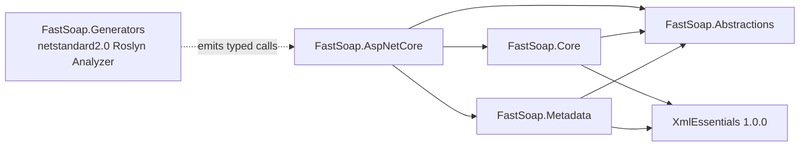
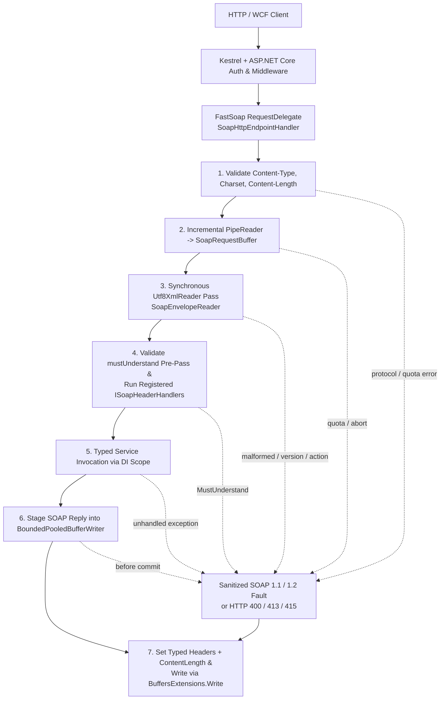

# FastSoap Architecture & How It Works

**FastSoap** is an experimental, Native AOT-first, UTF-8-native SOAP 1.1 and SOAP 1.2 runtime built directly on ASP.NET Core. Rather than hosting the legacy WCF channel stack, `Message` abstraction, or `System.Xml` DOM/reader pipeline, FastSoap processes SOAP envelopes directly as bounded UTF-8 byte spans using source-generated XML serialization ([CloudNimble/XmlEssentials](https://github.com/CloudNimble/XmlEssentials)) and typed static dispatch.

---

## 1. Design Principles

1. **Zero `System.Xml*` in Core Runtime Libraries:** `FastSoap.Abstractions`, `FastSoap.Core`, `FastSoap.AspNetCore`, and `FastSoap.Metadata` have zero assembly references to `System.Xml*`.
2. **No Reflection Fallback / No AOT Warning Suppressions:** All XML serialization, contract registration, and operation dispatch are statically typed and AOT-compatible (`IsAotCompatible=true`, `EnableTrimAnalyzer=true`, `EnableAotAnalyzer=true`, `TrimmerSingleWarn=false`). Runtime reflection scanning (`MethodInfo.Invoke`, `DynamicInvoke`, `Activator.CreateInstance`) is excluded by design.
3. **UTF-8 Native Hot Path:** Envelope parsing, namespace/QName matching, `charset=utf-8` validation, and response/fault serialization operate directly on UTF-8 bytes (`ReadOnlySpan<byte>` / `IBufferWriter<byte>`) without UTF-16 `string` or XML DOM round-trips.
4. **Explicit Buffer Ownership & Quotas:** Every pooled buffer has a single disposable owner (`ArrayPool<byte>`), deterministic `finally`-safe return, distinct logical length vs. rented capacity, optional buffer clearing (`ClearPooledBuffers`), and fail-first quota checks before allocating proportional to untrusted input.
5. **ASP.NET Core Platform Reuse:** Kestrel, routing, DI scopes, authentication, authorization (`.RequireAuthorization()`), TLS, rate limiting, and graceful shutdown are delegated directly to ASP.NET Core rather than re-implemented.

---

## 2. Package Architecture & Dependency Graph

| Project | Target | Responsibility |
|---|---|---|
| `FastSoap.Abstractions` | `net10.0` (C# 15) | Transport-neutral public contracts: `SoapVersion`, `SoapVersionFlags`, `SoapQName`, `SoapOperationDescriptor`, `SoapCallContext`, `SoapOperationHandler<TRequest, TResponse>`, `SoapFault`, `SoapFaultKind`, `SoapEndpointOptions`, `ISoapHeaderHandler`, `SoapProtocolException`, and contract attributes (`[SoapService]`, `[SoapOperation]`, `[SoapWireContract]`). Zero ASP.NET Core, Roslyn, or `XmlEssentials` dependencies. |
| `FastSoap.Core` | `net10.0` (C# 15) | Protocol & execution engine independent of Kestrel: bounded buffer owners (`SoapRequestBuffer`, `BoundedPooledBufferWriter`), internal `XmlEssentials` adapter, SOAP 1.1/1.2 `Content-Type`/`SOAPAction` parsers, synchronous `SoapEnvelopeReader`, immutable `FrozenDictionary` `SoapOperationTable`, `SoapHeaderProcessor`, `SoapResponseWriter`, `SoapFaultWriter`, and `SoapMessageProcessor`. |
| `FastSoap.AspNetCore` | `net10.0` (C# 15) | ASP.NET Core integration: `AddFastSoap`, `MapSoap`, `SoapEndpointBuilder`, plain `RequestDelegate` POST handler (bypassing minimal API reflection/parameter binding), `GET ?wsdl`/`?xsd` metadata serving, `ActivitySource`/`Meter` (`"FastSoap"`), and `[LoggerMessage]` structured logging. |
| `FastSoap.Metadata` | `net10.0` (C# 15) | Contract-first static WSDL 1.1/XSD registry (`SoapStaticMetadataProvider`), deterministic subset WSDL/XSD emitter (`SoapWsdlGenerator`), strict path normalization, SHA-256 ETags, and `SoapMetadataAddressPolicy` (never trusts untrusted `Host`/`X-Forwarded-Host` headers). |
| `FastSoap.Generators` | `netstandard2.0` (C# 12 subset) | Roslyn `IIncrementalGenerator` (`FastSoapContractGenerator`) emitting static `SoapOperationDescriptor` contracts, cached strict `XmlSerializerContext` instances, typed `Map<ServiceName>` endpoint extensions, and compile-time diagnostics (`FS0001`–`FS0008`). |

---

## 3. End-to-End Request Lifecycle

### Step-by-Step Mechanics

#### 1. Transport Validation & Bounded Intake
- `SoapHttpEndpointHandler` validates `Content-Type` (`text/xml` for SOAP 1.1, `application/soap+xml` for SOAP 1.2), UTF-8 charset (directly on UTF-8 spans without `string` allocation), and known `Content-Length` against `MaxRequestBytes` (default `1 MiB`) before reading the body.
- `SoapRequestBuffer.CopyFromPipeAsync` reads `HttpRequest.BodyReader` incrementally in a loop: checking remaining quota with checked arithmetic, copying each segment into a geometrically growing `ArrayPool<byte>` rental, and calling `BodyReader.AdvanceTo` in a `finally`-safe path so no pipe memory is retained and backpressure never stalls.
- On disposal, `SoapRequestBuffer` clears the written region when `ClearPooledBuffers = true` and returns the buffer to the same `ArrayPool<byte>` exactly once.

#### 2. Synchronous Parse Boundary (`Utf8XmlReader` ref struct)
Because `Utf8XmlReader` is a `ref struct`, all XML parsing and payload deserialization happen in a single synchronous pass (`SoapEnvelopeReader.ParseAndPrepare`) before any `await`:
- **Pre-scan & Security Guards:** Rejects XML 1.1, DTDs (`<!DOCTYPE`), processing instructions (`<?...?>`) in both envelope and body subtrees, and `encodingStyle` attributes. Enforces `XmlReaderOptions` quotas (`MaxDocumentByteCount`, `MaxDepth = 64`, `MaxAttributeCount = 64`, `MaxNameByteCount = 1024`, `AllowMultipleRoots = false`).
- **Envelope Grammar:** Validates expanded QName (`Envelope`, optional direct `Header`, exactly one direct `Body`, single operation element). Distinguishes non-`Envelope` roots (HTTP `400`) from `Envelope` with an unsupported namespace (SOAP `VersionMismatch`).
- **Header Scanning:** Enforces `MaxHeaderCount` (`32`) and `MaxHeaderBytes` (`64 KiB`), extracts owned `SoapHeaderValue` copies (so no borrowed spans escape the synchronous frame), and records SOAP 1.1 `actor` / SOAP 1.2 `role` and `mustUnderstand` lexical values.
- **Operation Routing:** Resolves operations from an immutable `SoapOperationTable` backed by `FrozenDictionary<string, ISoapOperation>` using `StringComparer.Ordinal` and `AlternateLookup<ReadOnlySpan<char>>` (zero-allocation routing). Secondary Body-QName fallback is used only when explicitly permitted and unambiguous; unknown or conflicting supplied actions are always rejected.
- **Typed Deserialization:** Validates the exact UTF-8 root `NamespaceUri` and `LocalName` of the Body child, then invokes `XmlSerializer.Deserialize(ref reader, requestTypeInfo)` within the live envelope reader's namespace scope using strict `XmlSerializerOptions` (`AllowDuplicateProperties = false`, `UnmappedMemberHandling = Disallow`, `OmitXmlDeclaration = true`).
- **Trailing Validation:** Verifies closing `</Body>`, `</Envelope>`, and EOF before returning a `PreparedSoapCall` (holding the deserialized typed request DTO and owned headers).

#### 3. Header Processing & Service Invocation
- `SoapHeaderProcessor.ProcessAsync` runs a **synchronous pre-pass** over all targeted headers first: if any targeted header with `mustUnderstand` lacks a registered `ISoapHeaderHandler`, it immediately throws a `MustUnderstand` fault (with SOAP 1.2 `NotUnderstood` header metadata) before executing *any* header handler or business logic.
- Non-targeted headers (e.g., another SOAP 1.1 `actor` or SOAP 1.2 `role/none`) are ignored as required by the SOAP specifications.
- Only after all transport, XML, header, and ASP.NET Core authorization checks succeed does the typed `SoapOperationHandler<TRequest, TResponse>` execute using `HttpContext.RequestServices` and `HttpContext.RequestAborted`.

#### 4. Staged Atomic Response & Sanitized Faults
- Responses are serialized through a single `Utf8XmlWriter` into a bounded `BoundedPooledBufferWriter` (`MaxResponseBytes`, default `2 MiB`).
- Because the full envelope is staged before committing HTTP headers, any serialization error or quota violation can still be converted cleanly into a sanitized SOAP Fault without emitting a truncated HTTP `200` body.
- On commit, `SoapHttpEndpointHandler` sets typed `response.Headers.ContentType` and `response.ContentLength`, writes the staged span via `System.Buffers.BuffersExtensions.Write(response.BodyWriter, stagedBytes.Span)` (avoiding multi-megabyte contiguous pipe rentals), and flushes with `RequestAborted`.
- Unhandled exceptions never leak internal messages or stack traces; they map to sanitized SOAP 1.1 `s:Server` or SOAP 1.2 `s:Receiver` faults, and no fault write is attempted if `response.HasStarted` or `RequestAborted.IsCancellationRequested`.

---

## 4. Source Generation & Cross-Generator Design

Standard Roslyn source generators cannot rely on seeing another generator's output in the same compilation. FastSoap avoids cross-generator ordering fragility by requiring explicit authored wire DTOs and an authored `XmlSerializerContext` subclass (`[XmlSerializable<T>]`), while `FastSoap.Generators` inspects `[SoapService]`, `[SoapOperation]`, and `[SoapWireContract]` metadata to emit:
- Static `<ServiceName>SoapContract` descriptor constants
- A cached `private static readonly` instance of the authored `XmlSerializerContext` configured with strict `XmlSerializerOptions` (`AllowDuplicateProperties = false`, `OmitXmlDeclaration = true`, `UnmappedMemberHandling = Disallow`)
- Typed `Map<ServiceName>(this IEndpointRouteBuilder endpoints, string pattern, Action<SoapEndpointBuilder>? configure = null)` extension methods delegating to the exact same `MapSoap` / `MapOperation` runtime API used by manual registration
- Compile-time diagnostics `FS0001` through `FS0008` for invalid namespaces, duplicate/ambiguous actions, unsupported method signatures, missing wire mappings, invalid QNames, inaccessible types, or naming collisions

All generator pipeline models (`ServiceContractModels`, `EquatableArray<T>`, `EquatableLocation`) are strictly value-equatable and never retain `ISymbol`, `Compilation`, `SyntaxTree`, or `Diagnostic` references across incremental steps.

---

## 5. WSDL 1.1 / XSD Metadata & Observability

- **Metadata (`FastSoap.Metadata`):** Disabled by default (`EnableMetadata = false`). When enabled on an endpoint, `GET ?wsdl` and `GET ?xsd=<name>` serve immutable cached UTF-8 documents with SHA-256 `ETag` (`304 Not Modified` support). Public endpoint addresses come strictly from `SoapMetadataAddressPolicy` (never derived from `Host` or `X-Forwarded-Host`), and external/remote schema resolution is prohibited.
- **Observability (`FastSoap.AspNetCore`):** Exposes `ActivitySource("FastSoap")` and `Meter("FastSoap")` with low-cardinality tags (`endpoint`, `operation`, `soap.version`, `fault.kind`, `outcome` — never raw `SOAPAction` or payload data) and `[LoggerMessage]` source-generated logging with zero payload logging.
